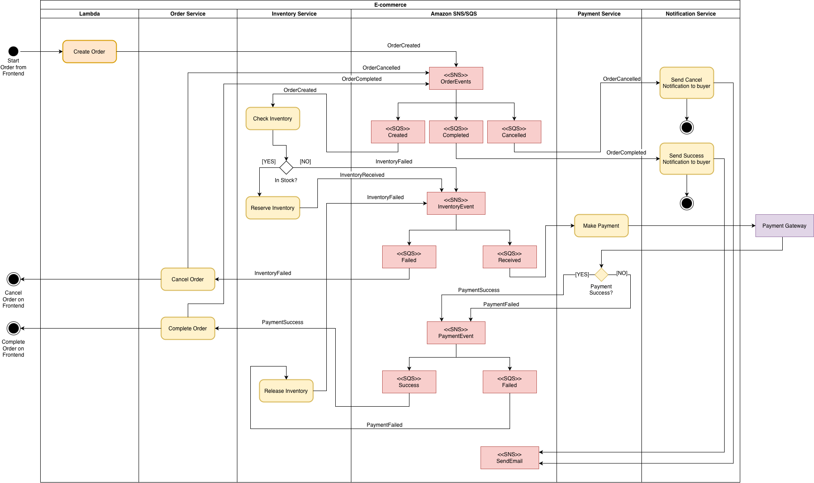
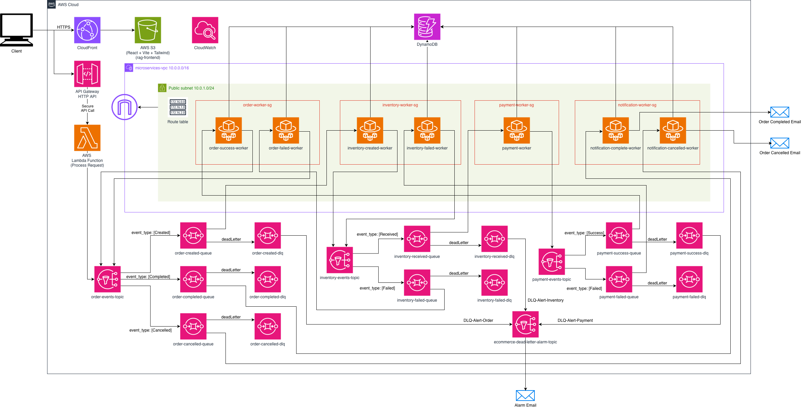

# aws-event-driven-ecommerce-saga
An enterprise-grade, event-driven e-commerce microservices platform built on AWS, implementing distributed transactions via the Saga Choreography pattern, resilient error handling, and a modern cloud-native deployment.

---

## 📐 Activity Diagram

## 📐 System Architecture Diagram

---

## 🚀 Key Architectural Highlights

1. **Event-Driven & Asynchronous Messaging:**
   - Decoupled microservices architecture utilizing **Amazon SNS** (Fanout pattern) and **Amazon SQS** for robust asynchronous event publishing and consumption.
2. **Distributed Transactions (Saga Choreography Pattern):**
   - Orchestrates multi-step order lifecycles (Order Creation $\rightarrow$ Inventory Deduction $\rightarrow$ Payment Processing) across asynchronous workers (**AWS ECS Fargate**) without a central coordinator.
3. **Data Consistency & Idempotency:**
   - Leverages **Amazon DynamoDB** conditional expressions (`attribute_not_exists`) and strict status state machines (`PENDING` $\rightarrow$ `COMPLETED` / `CANCELLED`) to prevent race conditions and duplicate processing.
4. **Resilience & Monitoring (DLQ & Alarms):**
   - Configured Dead Letter Queues (DLQ) for all SQS queues to safely capture poison messages, integrated with **CloudWatch Alarms** and **SNS** for real-time failure notifications.
5. **Full-Stack & Cloud-Native Deployment:**
   - Developed a real-time order tracking Single Page Application (SPA) using **React** and **Vite**, globally hosted via **Amazon S3** and **CloudFront (with OAC)**. Fully managed via **AWS CloudFormation (IaC)**.

---

## 🛠️ Tech Stack
- **Cloud / AWS:** Lambda, SQS, SNS, ECS Fargate, DynamoDB, API Gateway, S3, CloudFront, CloudFormation, CloudWatch
- **Backend:** Python, Boto3
- **Frontend:** React, Vite, JavaScript
- **Architecture:** Microservices, Event-Driven, Saga Pattern, IaC
